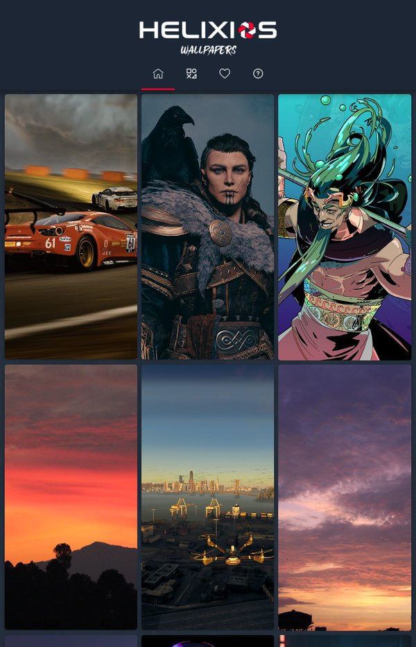
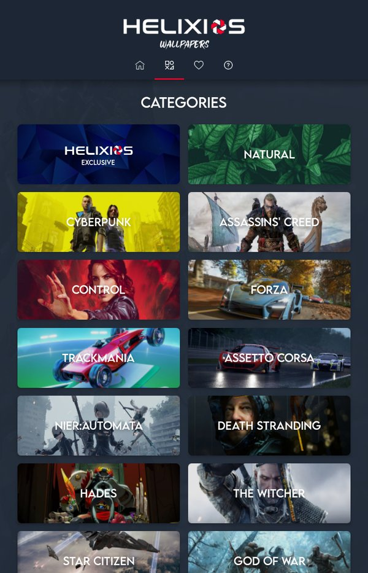
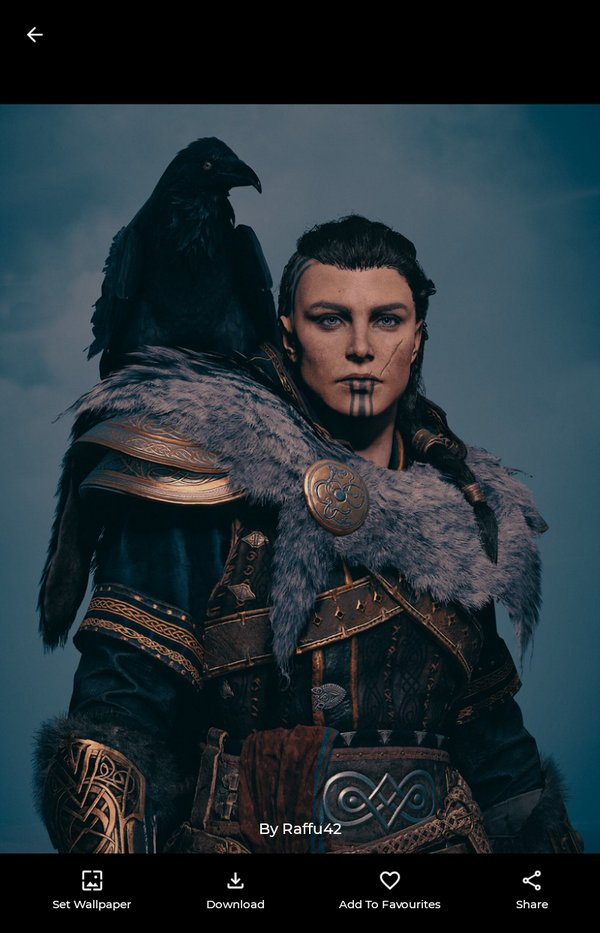
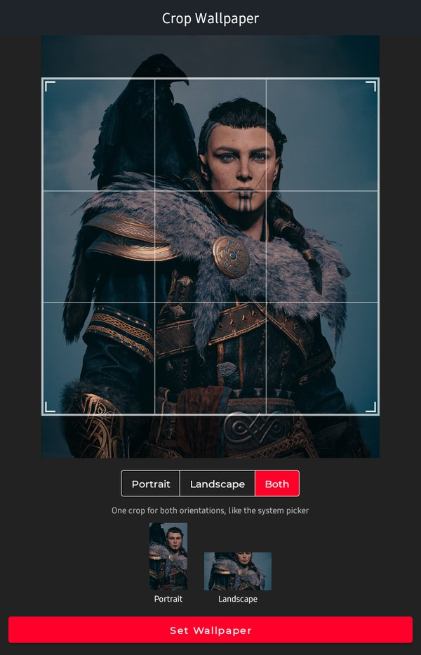
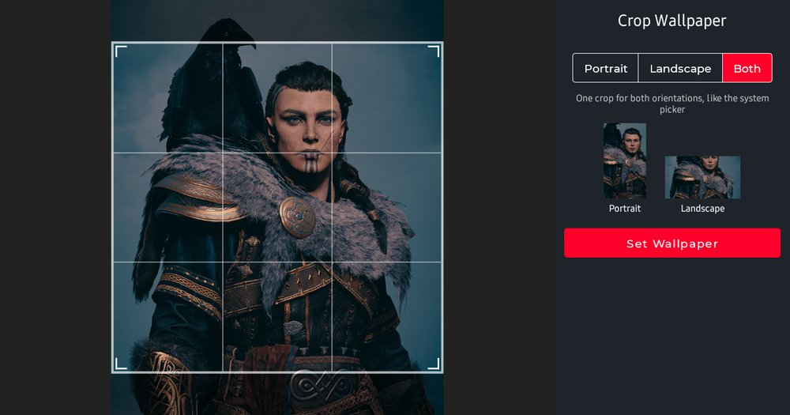

<h1 align="center">Helixios Wallpapers</h1>

<p align="center">
  Wallpapers from the Helixios eSports and Mirage communities at IET Lucknow,<br>
  served straight from Flickr to your home screen.
</p>

<p align="center">
  
  
  
  
  
</p>

<p align="center">
  <a href="https://play.google.com/store/apps/details?id=com.helixios.helixioswall">
    
  </a>
</p>

Helixios Wallpapers collects in-game screenshots and photographs taken by members of **Mirage**, the official photography club of IET Lucknow, and the **Helixios eSports** community. Browse the feed, filter by game, save favourites, and set any shot as your wallpaper, cropped to fit your phone or tablet in portrait, landscape or both.

## Screenshots

<p align="center">
  
  &nbsp;
  
  &nbsp;
  
  &nbsp;
  
</p>
<p align="center">
  
</p>

<p align="center"><sub>Home feed · Categories · Photo details · Crop screen (portrait and tablet landscape). Photo by Raffu42 on Flickr.</sub></p>

## Features

- **Curated feed**: everything shared to the club's [Flickr group](https://www.flickr.com/groups/14741456@N25/), shuffled on each refresh.
- **22 categories**: Helixios Exclusive, Natural, and 20 games including Cyberpunk, Forza, The Witcher, God of War and Death Stranding.
- **Favourites**: saved on the device and kept across app updates.
- **Download** the largest size Flickr allows, straight to your Downloads folder.
- **Set as wallpaper** for both the home and lock screen, with a built-in cropper:
  - **Portrait**, **Landscape** or **Both**. Both crops one square that works in either orientation, like the system wallpaper picker.
  - Live previews of what the home screen will show held upright and sideways.
- **Share** a link to the original photo on Flickr.
- Edge-to-edge layout and predictive back on modern Android; tested on Android 14.

## Download

Get the latest release from [Google Play](https://play.google.com/store/apps/details?id=com.helixios.helixioswall). The app runs on **Android 6.0 (API 23) and later**.

## Building from source

### Prerequisites

| Tool | Version |
| --- | --- |
| Android Studio | Latest stable (bundles a compatible JDK) |
| JDK | 17 or newer (Android Studio's bundled `jbr` works) |
| Android SDK | Platform 36 |
| Flickr API key | Your own, from the [Flickr App Garden](https://www.flickr.com/services/apps/create/) |

### Setup

1. Clone the repository:

   ```bash
   git clone git@github.com:HelixiosDevs/HelixiosWall.git
   cd HelixiosWall
   ```

2. Add your Flickr API key to `local.properties` in the project root. Android Studio creates this file, and git ignores it:

   ```properties
   flickr.api.key=YOUR_FLICKR_API_KEY
   ```

   The key is exposed to the app as `BuildConfig.FLICKR_API_KEY`. Without it every API call fails. **Never commit it.**

3. Open the project in Android Studio and run the `app` configuration, or use Gradle. From a terminal, point `JAVA_HOME` at a JDK 17+ first:

   ```bash
   ./gradlew assembleDebug      # build a debug APK
   ./gradlew installDebug       # install on a connected device or emulator
   ```

Debug builds use the application ID `com.helixios.helixioswall.debug`, so they install alongside the Play Store version.

### Tests and checks

```bash
./gradlew test                    # JVM unit tests
./gradlew connectedAndroidTest    # instrumented tests (needs a device)
./gradlew lint                    # Android lint
```

## Tech stack

| Area | Library |
| --- | --- |
| Language | Java 17 |
| UI | AppCompat, Material Components, ConstraintLayout, ViewPager, Lottie |
| Networking | Retrofit 2 + Gson, against the Flickr REST API |
| Images | Glide |
| Persistence | Room |
| Cropping | CanHub Android-Image-Cropper |
| Build | Gradle 9.1, Android Gradle Plugin 8.13 |

## Project structure

```text
app/src/main/java/com/helixios/helixioswall/
├── FullscreenActivity.java        # Animated splash screen
├── MainActivity.java              # Tabs: home, categories, favourites, about
├── home_frag.java                 # Group feed
├── category_frag.java             # Category grid → SelectedCategoryActivity
├── favour_frag.java               # Favourites (Room)
├── PhotoActivity.java             # Photo details: download, wallpaper, favourite, share
├── CropActivity.java              # Portrait / Landscape / Both cropper
├── adapters/                      # RecyclerView adapters
├── database/                      # Room database and DAO
├── model/                         # Flickr response models (Photo doubles as the Room entity)
└── networking/                    # Retrofit client, Flickr endpoints, download receiver
```

## Flickr API notes

- Photos come from `flickr.groups.pools.getPhotos` (home feed) and `flickr.photos.search` (categories), with the `url_z` to `url_o` size extras.
- Image URLs use `live.staticflickr.com`; the older `farmN.staticflickr.com` addresses are deprecated.
- Since May 2025 Flickr withholds originals and sizes above 1024px for photos from Free accounts. The app downloads the largest size Flickr returns and falls back to 1024px, so some wallpapers are limited to that size.
- Flickr reports API errors as HTTP 200 with `"stat": "fail"`, and the app checks for this before reading results.
- New API keys are currently issued to Flickr Pro members only.

## Contributing

- **Photos**: share your shots in the [Flickr group](https://www.flickr.com/groups/14741456@N25/discuss/72157719228128509/) to have them featured.
- **Code**: fork the repository, create a branch, and open a pull request against `main`. Please check that `./gradlew test lint` passes and that your change works on both older (API 23–28) and current (API 33+) Android versions.
- **Bugs and ideas**: open an [issue](https://github.com/HelixiosDevs/HelixiosWall/issues).

## Team

| | Role |
| --- | --- |
| [Aditya Chaudhary](https://www.linkedin.com/in/aditya-chaudhary-50a680a6/) | App development |
| [Divyansh Tripathi](https://www.linkedin.com/in/divyansh-in/) | UI/UX design |

Built by [Helixios eSports](https://www.helixios.tech/), the unofficial gaming club of IET Lucknow. Photography by the members of Mirage and the Helixios community; every photo is credited to its Flickr author in the app.

**Community:** [Website](https://www.helixios.tech/) · [Instagram](https://www.instagram.com/helixios.esports/) · [YouTube](https://www.youtube.com/HelixiosCorp) · [Discord](https://discord.com/invite/tpNjxdr) · [Telegram](https://t.me/helixiosesports) · [Facebook](https://www.facebook.com/helixios.esports)

## License

No license has been chosen for this repository yet. Until one is added, all rights are reserved by the authors. Photos remain the property of their respective photographers on Flickr.
